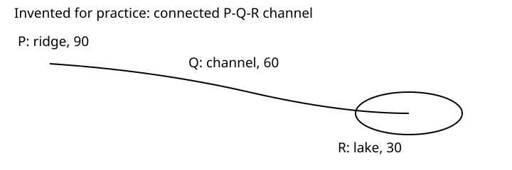

# Section 5.2: covered independent paper

Keep covered until independent work. Print one day only.
Each record headed invented is invented for practice.

## Day 89

[[s05-X89-1]]

| Model |
| --- |
| &nbsp; |
| &nbsp; |
| &nbsp; |
| &nbsp; |
| &nbsp; |
| &nbsp; |

[[s05-X89-2]]

________________________________________________________________

________________________________________________________________

________________________________________________________________

## Day 90

[[s05-X90-1]]

________________________________________________________________

________________________________________________________________

________________________________________________________________

[[s05-X90-2]]

________________________________________________________________

________________________________________________________________

________________________________________________________________

## Day 91

[[s05-X91]]

| Model |
| --- |
| &nbsp; |
| &nbsp; |
| &nbsp; |
| &nbsp; |
| &nbsp; |
| &nbsp; |
