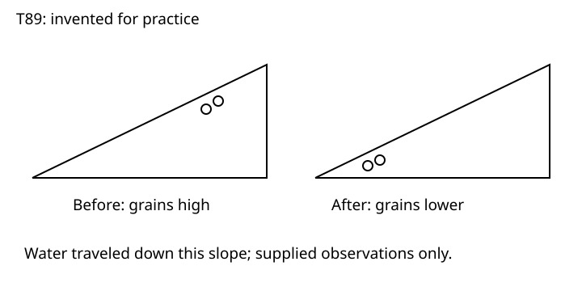

# T89: supplied tray sequence

Invented for practice. These are supplied drawings, not photographs or class observations.
Say this aloud before using T89. It is weaker than collecting your own evidence.

| Supplied view | Raw observation |
| --- | --- |
| Before | Dark grain marks are on the upper slope. |
| During | Water travels down the slope. |
| After | Dark grain marks are lower; a small pile lies near the bottom. |

Use tray-record.md with its supplied-invented tag.
Retain the separate actual entry, even when unclear.
