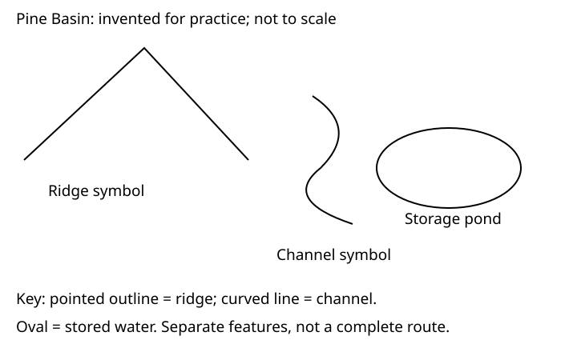

# Map components and source notes

Pine Basin is invented for practice. It is not the classroom's local watershed.
Its key and isolated terrain features are supplied for practice.
The invented supply note names a storage pond as a source, without testing results.

## Separate dated source note

An April 8, 2026 municipal account names Cedar and Tolt watersheds as supply sources.
[Read the source account](https://atyourservice.seattle.gov/2026/04/08/our-water-supply-this-spring-what-you-need-to-know/).
This names sources, not current shortage, treatment or safety.
[Public terrain-map program](https://www.usgs.gov/programs/national-geospatial-program/national-map).
A checked local extract can replace Pine Basin later; no live map is needed today.

[[s05-P90]]

________________________________________________________________

________________________________________________________________

________________________________________________________________
