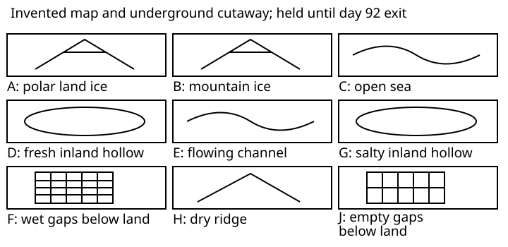
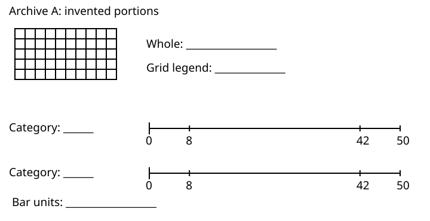
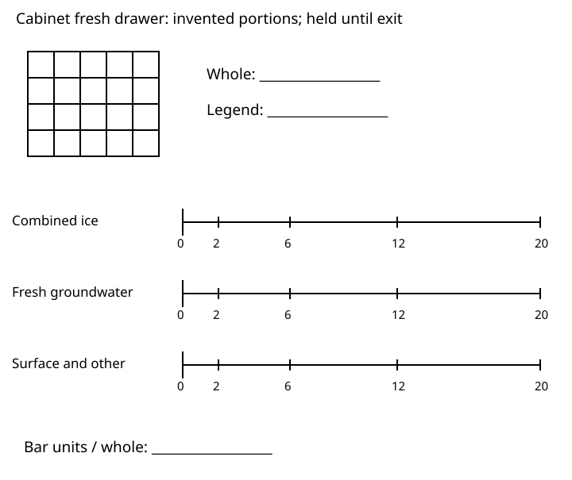
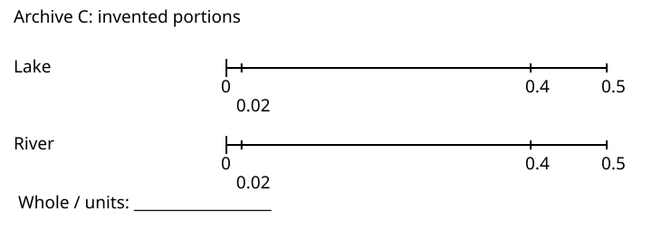

# Section 5.3: covered independent paper

Keep covered until independent work. Print one day only.
Each record headed invented is invented for practice.

## Day 92

[[s05-X92]]

## Day 93

[[s05-X93]]

## Day 94

[[s05-X94]]

## Day 95

[[s05-X95-1]]

_______________________________

[[s05-X95-2]]

_______________________________
