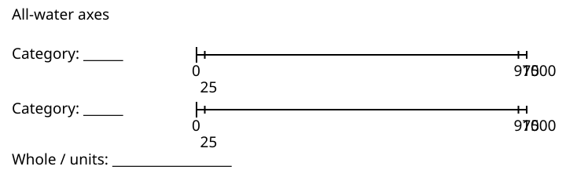
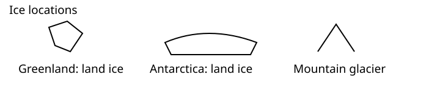

# Day 98: island and water atlas

Name: __________________ Date: __________

The island setting is invented for practice. Earth shares are supplied estimates.

## Q1, 15 minutes

[[s05-Q1a]]

| Model |
| --- |
| &nbsp; |
| &nbsp; |
| &nbsp; |
| &nbsp; |
| &nbsp; |
| &nbsp; |

[[s05-Q1b]]

________________________________________________________________

________________________________________________________________

[[s05-Q1c]]

________________________________________________________________

________________________________________________________________

[[s05-Q1d]]

________________________________________________________________

________________________________________________________________

[[s05-Q1e]]

________________________________________________________________

________________________________________________________________

## Q2a, 8 minutes

[[s05-Q2a1]]

________________________________________________________________

________________________________________________________________

[[s05-Q2a2]]

________________________________________________________________

________________________________________________________________

## Q2b, 10 minutes

[[s05-Q2b1]]

________________________________________________________________

________________________________________________________________

[[s05-Q2b2]]

________________________________________________________________

________________________________________________________________

## Q2c, 7 minutes

[[s05-Q2c1]]

________________________________________________________________

________________________________________________________________

[[s05-Q2c2]]

________________________________________________________________

________________________________________________________________

[[s05-Q2c3]]

________________________________________________________________

________________________________________________________________

Five minutes: check your work before collection.
