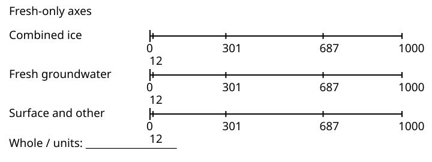
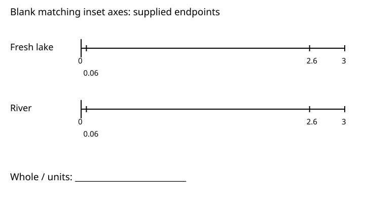

# Day 98 assessment

Name: __________________ Date: __________

## Side 1

Island records are invented for practice. Earth shares are supplied estimates.

[[s05-Q1a]]

| Annotated model |
| --- |
| &nbsp; |
| &nbsp; |
| &nbsp; |
| &nbsp; |
| &nbsp; |

[[s05-Q1b]]

_______________________________________________________________

[[s05-Q1c]]

_______________________________________________________________

[[s05-Q1d]]

_______________________________________________________________

[[s05-Q1e]]

_______________________________________________________________

[[s05-Q2a1]]

[[s05-Q2a2]]

_______________________________________________________________

## Side 2

[[s05-Q2b1]]

[[s05-Q2b2]]

_______________________________________________________________

[[s05-Q2c1]]

[[s05-Q2c2]]

_______________________________________________________________

[[s05-Q2c3]]

_______________________________________________________________

Check before collection.
