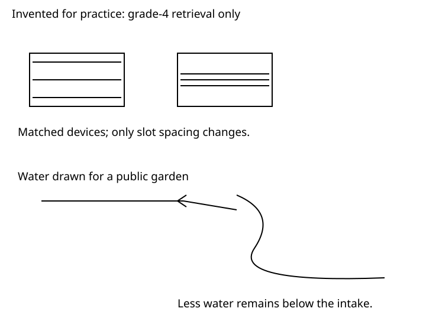

# Design and resource reminder

Invented for practice. Review earlier grade-4 design and resource work.
Natural resource: material or energy supply found in nature.

Name: __________________ Date: __________

One changed feature in the two device pictures: __________________

Resource-to-stream link in the second picture: __________________

An uncertain idea to revisit: __________________

The teacher forwards these notes to days 100 and 103.
This is a retrieval note, not a new readiness check.
