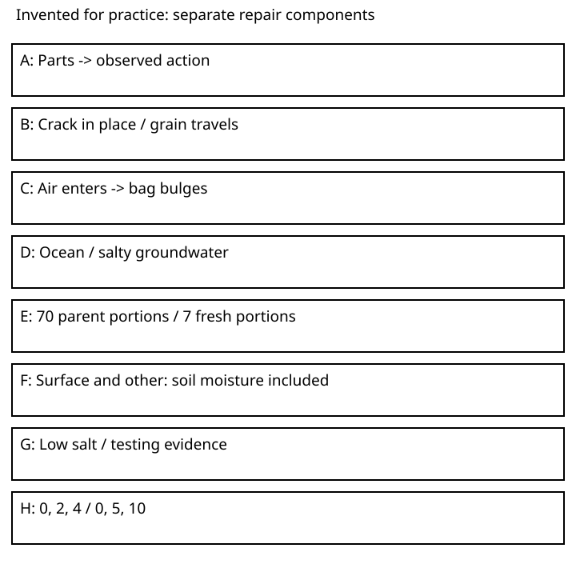

# Day 99: component repair packets

Use only your assigned component packet. Records are invented for practice.

## Packet A

[[s05-P99-A]]

________________________________________________________________

________________________________________________________________

## Packet B

[[s05-P99-B]]

________________________________________________________________

________________________________________________________________

## Packet C

[[s05-P99-C]]

________________________________________________________________

________________________________________________________________

## Packet D

[[s05-P99-D]]

________________________________________________________________

________________________________________________________________

## Packet E

[[s05-P99-E]]

________________________________________________________________

________________________________________________________________

## Packet F

[[s05-P99-F]]

________________________________________________________________

________________________________________________________________

## Packet G

[[s05-P99-G]]

________________________________________________________________

________________________________________________________________

## Packet H

[[s05-P99-H]]

________________________________________________________________

________________________________________________________________

