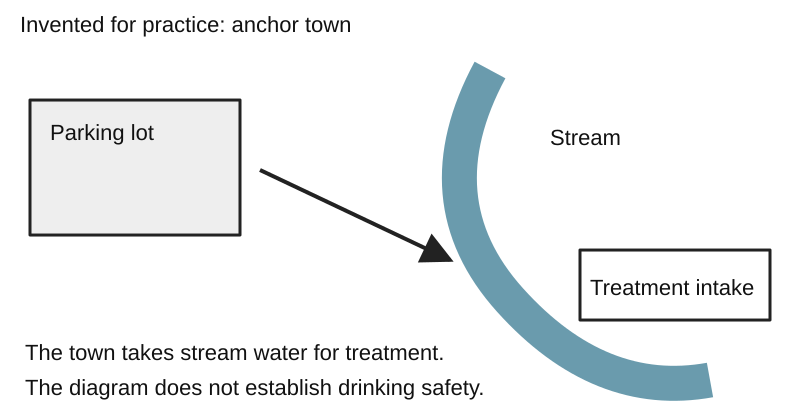

# Runoff noticing record

## Public photograph

[Urban Stormwater Runoff](https://www.usgs.gov/media/images/urban-stormwater-runoff)

Photograph: Jason Masoner, United States Geological Survey, 2017. Public domain.
Look at visible details before explanations. The image cannot identify invisible contaminants.
Source row: S06-photo.

## Original anchor

Invented for practice. This is a schematic, not a photograph or measured town record.
If the photograph cannot display, use this schematic and record the missing photo observation.
The stream water goes to treatment; the diagram does not show untreated water being drunk.

Name: __________ Notice: ____________________________________

One source location: ________________________________________
