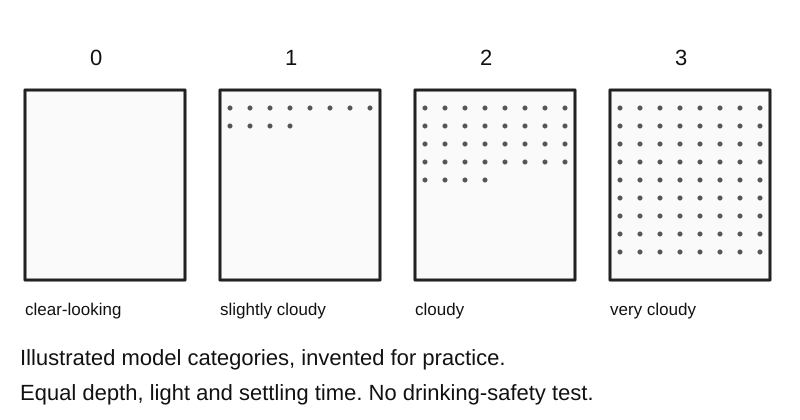

# Cloudiness comparison reference

Invented for practice. These drawings are model references, not photographs or calibrated measurements.
0: clear-looking. 1: slightly cloudy. 2: cloudy. 3: very cloudy.
Keep sample depth, light and settling time equal.
If references cannot distinguish a sample, record a range or unresolved with a reason.
Categories are ordered descriptions, not equal numeric intervals. Do not average them.
Clear-looking never means safe to drink. Never taste any sample.
Record source: S06-original. Safety reference: S06-filter-safety.
