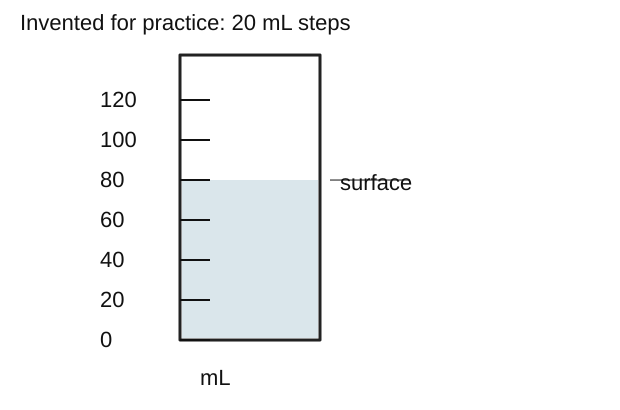

# Separate measurement cards

## Volume in cups

Use a measuring cup with half-cup marks.
Align your eye with the surface. Read within its marked steps.
Check the actual half-cup fill mark before rounding for a plot.
Between-mark readings are estimates. Unreadable readings remain unresolved with a reason.
A spoon positions materials; it does not convert units.

## Milliliters

Milliliter, mL: a unit for water volume.
The pictured practice cylinder has 20-milliliter marks, starting at zero.
Its fourth mark above zero is the practice reading.
Do not assume the classroom cup has this cylinder's steps.

## Timing

The timer measures water collection over an equal interval, never student speed.
Start at zero. Stop collection at 60 seconds for classroom filter trials.
Pour for ten seconds inside that interval.
Compare cloudiness after twenty seconds of settling, with equal depth and light.

## Failed reading

Try one safe reread within the scheduled cycle.
If it remains unreadable, write unresolved and the reason.
Keep invented backup on a separate slip.
