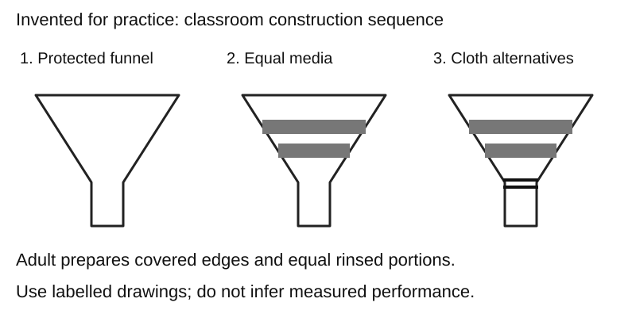

# Classroom construction record

Invented for practice. These are schematic records, not photographs or observations of your group.
An adult prepares blunt covered edges, stable supports and equal rinsed portions.
Use one paper support in each filter. Change only cloth-layer count.
Each prototype uses one quarter-cup sand and one quarter-cup gravel.
Inspect version labels against your earlier drawing.
For no-kit work, annotate these drawings and keep construction evidence unobserved.
No measured performance is supplied by this illustration.

Name: __________ Version: __________

Observed personal action or records-only annotation: ______________________

Fixed portion checked: __________________________________________
