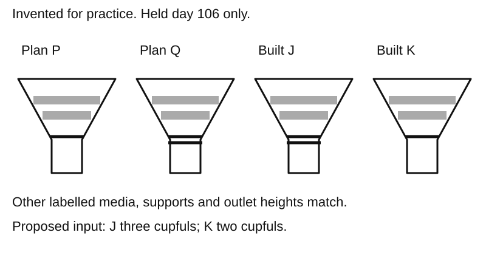

# Section 6.3: held independent paper

Print one day only. Cover until independent work. Read invented labels aloud.

## Day 106

### s06-X106-1

Invented for practice. Plan P has one cloth layer; Q has two. Other media, supports and outlet heights match. Built record J shows two cloth layers; K shows one. J would receive three level cupfuls; K would receive two. Match each built filter to its plan.

________________________________________________________________

________________________________________________________________

________________________________________________________________

### s06-X106-2

Using the input record, annotate the correction needed for a fair comparison.

________________________________________________________________

________________________________________________________________

________________________________________________________________

## Day 107

### s06-X107

Invented for practice. A rack tips after a different demonstration. Shuffled snapshots preserve these trials. Volumes use milliliters; cylinders have 20-milliliter marks. L2: 120, category 1, no problem. K3: 60, category 3, no problem. K1: 60, category 2, no problem. L3: 100, category 2, tilted pour. K2: 80, category 2, side leak. L1: 100, category 1, no problem. Rebuild the six-trial record with units, categories and problems.

________________________________________________________________

________________________________________________________________

________________________________________________________________

## Day 108

### s06-X108

Invented for practice. Storage liners release water through intended spouts. Each receives three cupfuls under matching conditions. Outlet cups: M1 1.5, M2 2, M3 1.5; N1 2.5, N2 0.5, N3 2.5. Values match half-cup marks. N2's seam leaked; M2's pour started above the guide. A draft graph omits N2. Replace it with complete line plots annotated with trial identifiers, units and problems.

________________________________________________________________

________________________________________________________________

________________________________________________________________

| Drawing or plot |
| --- |
| &nbsp; |
| &nbsp; |
| &nbsp; |

