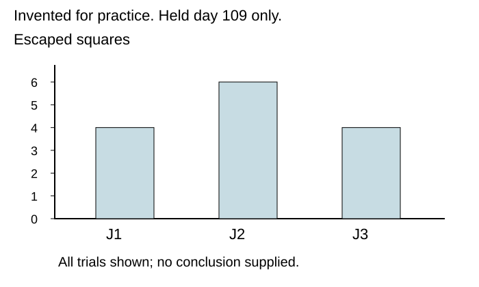

# Section 6.4: held independent paper

Print one day only. Cover until independent work. Read invented labels aloud.

## Day 109

### s06-X109

Invented for practice. A roof-drain screen has a split seam. Graph: J1, four escaped squares; J2, six; J3, four. Every escape occurred at the split. Goal: no more than one escaped square. Limit: one repair strip and unchanged screen area. Draw one constrained repair, linking your change to the repeated graph evidence.

________________________________________________________________

________________________________________________________________

________________________________________________________________

| Drawing or plot |
| --- |
| &nbsp; |
| &nbsp; |
| &nbsp; |

## Day 110

### s06-X110

Using your retained baseline and retests, revise the water-route drawing from your results.

________________________________________________________________

________________________________________________________________

________________________________________________________________

| Drawing or plot |
| --- |
| &nbsp; |
| &nbsp; |
| &nbsp; |

## Day 111

### s06-X111

Invented for practice. Use the held hopper record and your plots. Goals: collect at least one cup and improve input category 2 by one category. Avoid side leaks. Limit: two pads. Use every goal and limit to recommend a design with one evidence limit.

________________________________________________________________

________________________________________________________________

________________________________________________________________

