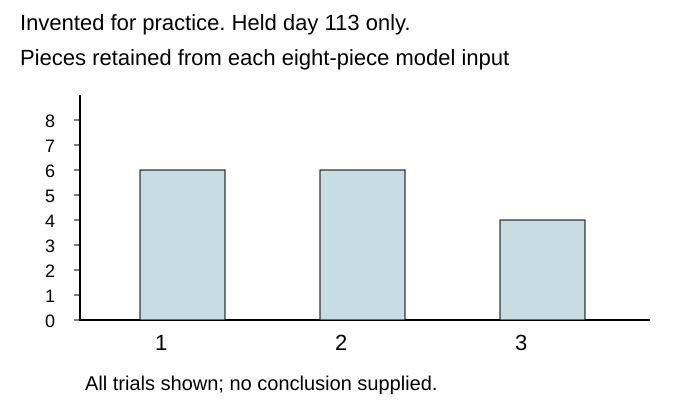

# Section 6.5: held independent paper

Print one day only. Keep covered until independent work.
Read invented labels aloud. No teacher key belongs on this sheet.

## Day 112: s06-X112

Invented for practice. Community record L: Crews remove pavement leaves before rain reaches the drain. Equal-input model trials count large paper leaves entering a pipe. Loose-leaf model: 6, 7, 6. Swept model: 2, 2, 3. Neither record measures tiny material. Combine the community record and trial data into one protection claim with a limit.

________________________________________________________________

________________________________________________________________

________________________________________________________________

## Day 113: s06-X113

Invented for practice. A new footbridge drains toward our anchor stream. F1: A community basket catches large litter below the bridge drain. F2: Smaller pieces can pass toward the stream. Mini-graph: eight-piece equal model inputs retain 6, 6 and 4 pieces. Trial 3 notes a torn corner. Explain this new stream route with source-linked arrows, the graph and one limit.

________________________________________________________________

________________________________________________________________

________________________________________________________________

| Drawing or plot |
| --- |
| &nbsp; |
| &nbsp; |
| &nbsp; |

## Day 114: s06-X114-1

Invented for practice. Park record: Our planted hollow holds roof runoff after rain. Science card: Soil and roots slow water and trap some carried material. Explain the cards' land-and-water connection with one limit.

________________________________________________________________

________________________________________________________________

________________________________________________________________

## Day 114: s06-X114-2

Invented for practice. Proposed catcher P receives one cup; Q receives two cups. Mixture, pour height and timing match. Identify and repair the comparison flaw.

________________________________________________________________

________________________________________________________________

________________________________________________________________
