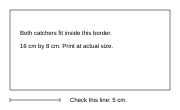

# Held day 116 problem card

Invented for practice. Keep concealed until day 116.
Compare two prepared shallow runoff catchers differing only in barrier height.

Goal: no more than 10 mL escapes through the outlet in five seconds.
Avoid side leakage. Both catchers must fit inside the printed footprint.
Use only the supplied channel and barrier materials.

Each trial uses 20 mL from the same freshly stirred classroom mixture.
Pour for two seconds at the agreed position. Collect outlet water until five seconds.
Read the outlet volume with the unused measuring cup's 1 mL marks.
Prewet both catchers equally. Use identical drain/reset rules.
Alternate three trials per catcher. Retain every value and problem.
The timer measures water movement, not student speed.

If a reading fails, try one safe reread within its scheduled cycle.
Then record unresolved and reason; do not invent a replacement.
