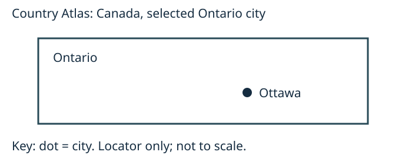
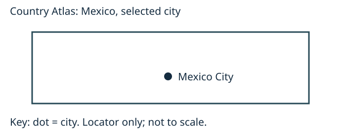

# Country Atlas

## Canada page

Original locator. Facts: Canadian regional development department, Map of Canada, A-2, 1969.
Only the selected city/province relationship is used.

## Mexico page

Original locator. Facts: national history museum record, Mexico City.

These are a collection of selected locator maps, not complete country maps.
Read the source register for URLs and rights.
