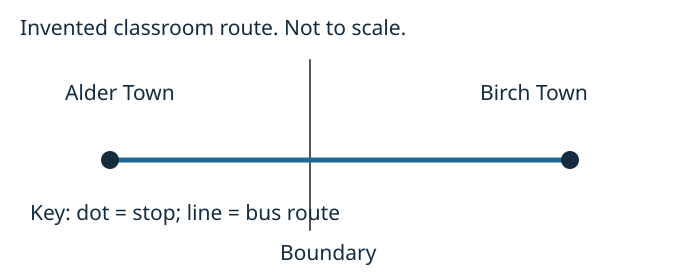

# Day 17: Begin our neighbor inquiry

## Teacher page

### Before class
Use the generated key for practice; use key-exits.md for exits. Read opener.md and teacher-only key-exits.md. Prepare record.md, question-board.md and family.md. Display country-atlas.md and goods-map.md using country-atlas-canada.svg, country-atlas-mexico.svg and goods-connections.svg; keep exits hidden. The student page incorporates practice-17.md and town-bus.svg. Print no duplicate practice sheet. Send the family note today; students 18 or older receive it themselves.

### The day
#### 5 min. Warm-up, Open the inquiry
Return day 16's fresh repairs with written cues during the first minute; retain folders. Honor its Tomorrow: open the Canada, Mexico and United States inquiry. Compare the Country Atlas locators with the Goods Connections Map. Boxes are schematic frames, not country outlines. Review trade: goods move from where made to where sold. The arrows show selected exchanges, not distances. Explain all classroom stories and families are made up.

Use [[s02-P17-H]] to compare the two opening displays. Hear four 45-second comments; everyone else records a short contrast. Return all hook notes with day 17 work on day 18.

#### 8 min. Retrieve questions and evidence
Review big question: a question too large to answer at once. Review claim and evidence: an answer supported by a detail. Children complete [[s02-P17]] and [[s02-P17b]] alone using the bus diagram. Hear six volunteers at 45 seconds each, 4.5 minutes; record names. Everyone may pass publicly. Inspect all papers for day 18's retrieval repair.

#### 10 min. Question board
Review the question board: supporting questions with answer days. Use [[s02-K17-1]] before revealing its steps.
[[steps:s02-K17-1]]
Pairs place their smaller questions under sources, country, explanation or trade. Co-write the board's five questions, retaining its answer days. Review day 1's importance to another reader: inquiry answers can help people make choices beyond this classroom. Do not rehearse the exit case.

#### 12 min. Team choice
Pairs complete [[s02-P17-2]], each taking 45 seconds to share a country and question. Each child keeps an individual question, even when partners choose together. Discuss classroom research choices only. Spend remaining minutes reading labels and revising questions that cannot be researched. Collect pages; return them day 18.

#### 5 min. Exit ticket
Reveal exit-17.md, exactly [[s02-X17]]. Children respond independently on the half slip; accept a labeled drawing or neutral dictation. Collect all. After class, allow 30 children times 30 seconds, 15 minutes, for exits; 30 times 45 seconds, 22.5 minutes, for practice. Use shown, shown with help, not yet seen for each component; record access separately.

### Other rooms
Display paper diagrams without a screen. No printer: copy the short student sources and questions; keep the exit separate.

### At home
**Swap.** No copies: draw the bus diagram and copy the exit separately.
**Skip.** Team organization and public turns.
- **5 min. Open.** Look at the atlas and goods diagrams together.
- **8 min. Retrieve.** Your child completes [[s02-P17]] and [[s02-P17b]]. **Say.** "Which detail supports your claim?" Expect: the route connects the towns across their boundary.
- **10 min. Questions.** Read [[s02-K17-1]], then its steps. Make the question board together.
- **7 min. Choose.** Complete [[s02-P17-2]]. Let your child choose either country.
- **5 min. Exit ticket.** Reveal [[s02-X17]]; your child answers alone. Discuss the key afterward.

### Shorter or longer
Shorter: cut public sharing, retaining retrieval, country choice and exit. Longer: revise a question to fit a visible source detail.

### Words and supports
Review supporting question, claim, evidence and question board. Read neutrally, enlarge diagrams or take dictation. Do not request personal family information.

### Tomorrow
Day 18 names source kinds. Return s02-X17 and all practice. Error P, only class interest, gets a fresh source-user move in Return and repair and Source work. Question/detail misses get the separate ten-minute Retrieval repair.

### Credit
Ours. Source s02-atlas-teach supports the Canada locator; Source s02-castle supports Mexico City. Source s02-canada-mexico-trade supports the selected goods arrows.

## Student page

### Side 1
**Opening comparison.**
[[s02-P17-H]]
Difference: ____________________

**I can begin an inquiry and explain why it matters to another reader.**
Review: a big question needs smaller supporting questions.
Our big question: How are Canada, Mexico and the United States tied together?

Made-up classroom bus diagram. Not to scale.

[[s02-P17]] {small}
[[s02-P17b]] {work}

### Side 2
Review: a claim needs a supporting detail.
[[s02-K17-1]] {small}
[[s02-P17-2]] {work}
Keep your question in your research folder after feedback.
You may pass during public sharing.
