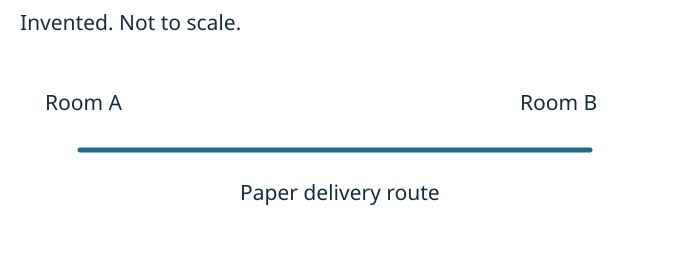

# Day 18: Read source kinds and contents

## Teacher page

### Before class
Use the generated key for practice; use key-exits.md for exits. Read opener.md and teacher-only key-exits.md; prepare record.md. Return day 17's papers with one private cue. The student page replaces practice-18.md and retry-route.svg. Lay out the retained country-atlas.md, goods-map.md, country-atlas-canada.svg, country-atlas-mexico.svg, goods-connections.svg and question-board.md. Keep exit-18.md separate. Supply the printed key again; no missing reference card is needed.

### The day
#### 5 min. Warm-up, Return and repair
Return s02-X17, the opening note s02-P17-H, and day 17's written task: s02-P17, s02-P17b, s02-K17-1, s02-P17-2. If many show error P, teach one fresh user move with [[s02-P18-R]]. Otherwise meet that group while others write. Point to the information need before reading any source title. Children identify that component; do not rehearse a complete importance explanation.

#### 10 min. Retrieval repair
First two minutes: review grade 3 biography source kinds and keeping findings with sources. Read the made-up Asha note on the student page. Use [[s02-P18-BIO1]] and [[s02-P18-BIO2]]. Next eight minutes: review day 17's question and evidence using retry-route.svg and [[s02-P18-1]]. Model its room labels, then collect a fresh question/detail attempt. This is separate from exit repair. Others annotate the key independently.

#### 8 min. Source kinds
Review source kinds: a photograph, a letter, a map, a story people tell. Review day 2's legend, the map key. Point to the supplied dot and arrow meanings. Introduce atlas, a collection of maps; article, a written explanation; printed digital page, a paper copy from a screen. A digital page can also contain an article or map: format and kind can overlap. Use [[s02-K18-1]] before revealing steps.
[[steps:s02-K18-1]]

#### 12 min. Source work
First five minutes extend error P repair using [[s02-P18-R]]; other children label independently. Complete [[s02-P18]] and [[s02-P18-2]]. Partners each take 45 seconds to explain one label, 90 seconds total. Read the atlas and goods-map titles as class examples. Their different contents matter more than decoration. Collect pages; retain sources and question board. Return work day 19.

#### 5 min. Exit ticket
Reveal exit-18.md, exactly [[s02-X18]]. Everyone writes independently on the half slip; accept neutral dictation. Collect all. Mark afterward: 30 children times 45 seconds, 22.5 minutes, for exits; 30 times 60 seconds, 30 minutes, for practice. Use shown, shown with help, not yet seen per component; access support is separate.

### Other rooms
Copy the short source set and fresh route on paper without a printer. Use paper displays; no live digital page is needed.

### At home
**Swap.** No copies: draw the fresh route and copy today's short sources.
**Skip.** Public sharing and team grouping.
- **5 min. Return.** Read yesterday's cue. Complete [[s02-P18-R]].
- **10 min. Retrieve.** Read the room labels together. Complete [[s02-P18-1]].
- **8 min. Kinds.** Work [[s02-K18-1]] before reading its steps. Label [[s02-P18]].
- **7 min. Contents.** Complete [[s02-P18-2]]. **Say.** "What makes that detail useful?" Expect: it answers where the boxes go.
- **5 min. Exit ticket.** Reveal [[s02-X18]]. Your child answers alone. Discuss the key afterward.

### Shorter or longer
Shorter: reduce label sharing, preserving both repairs and the exit. Longer: describe two formats that could carry the same source kind.

### Words and supports
Review source kinds and legend. Enlarge labels or read them neutrally. Keep source text visible while children dictate.

### Tomorrow
Day 19 reads makers, kinds and dates. Return s02-X18 and practice. Error J, decoration over contents, or a missing experience source gets one fresh move in Return and repair and Metadata work. No extra spoken queue.

### Credit
Ours. Source s02-atlas-teach, Source s02-castle and Source s02-canada-mexico-trade support retained real-place diagrams. Classroom sources and route are made up.

## Student page

### Side 1
**I can name source kinds and explain what their contents show.**
Review: source kinds include maps, letters, photographs and stories people tell.
Fresh classroom delivery route, made up. Not to scale.

Legend: line = paper delivery route.
[[s02-P18-R]] {small}
**Review a biography note.** Asha and the classroom article are made up.
Source label: Classroom article, 2026.
Finding: Asha organized a room cleanup.
[[s02-P18-BIO1]]
Answer: ____________________
[[s02-P18-BIO2]]
Source label: ____________________
Finding: ____________________
[[s02-P18-1]] {small}
[[s02-K18-1]] {small}

### Side 2
Classroom source set, made up for readers in 2026.
A. One room drawing shows a desk and door.
B. A booklet holds a room map and a yard map on separate pages.
C. An explanation describes how caretakers prepare equipment before visitors arrive.
D. A paper copy of the classroom office's web page lists stored equipment.
Use D's format label; kinds and formats can overlap.
[[s02-P18]] {small}
Office detail: Labeled equipment boxes go on the bottom shelf.
[[s02-P18-2]] {work}
Review key: a dot means city on the Country Atlas.
An arrow means goods moving on the Goods Connections Map.
