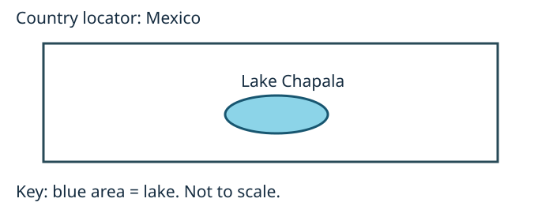

# Day 22 exit ticket

Map origin: INEGI, 2010. Geography card origin: NASA Ciencia, undated.
Card: Lake Chapala is in Mexico.

**s02-X22**

Use the map and separately authored geography card. Compare their information about Lake Chapala's country, including one limit of agreement.

_________________________________________________________________

_________________________________________________________________

_________________________________________________________________
