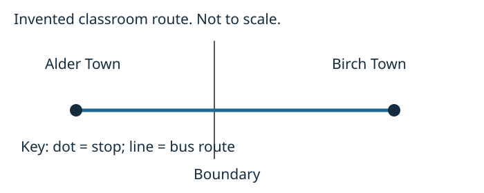

# Day 17 component work

Use the Country Atlas and Goods Connections Map for the opening only.

**s02-P17**

Write a smaller question about the made-up two-town bus diagram.

______________________________________________________________________

______________________________________________________________________

**s02-P17b**

Write a claim supported by one detail from the bus diagram.

______________________________________________________________________

______________________________________________________________________
