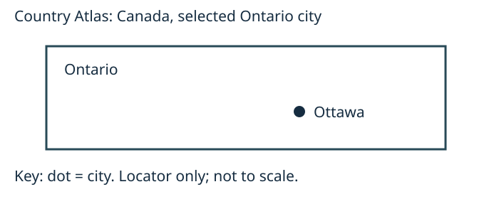
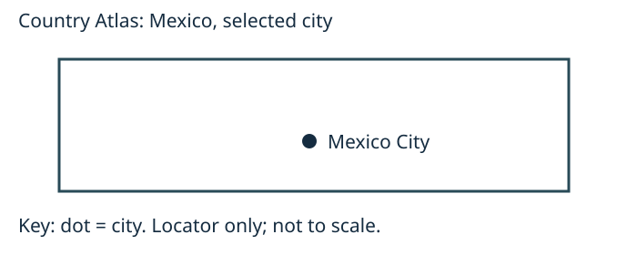

# Day 25: Cities, land, and landmarks

## Teacher page

### Before class
Read teacher-only key-exits.md and the generated key, including the built-canal distinction. Prepare land-sources.md, topic-notes.md (s02-u02-2-topic-notes), source-log.md, question-board.md and record.md. The student page incorporates practice-25.md, country-atlas.md locators, country-atlas-canada.svg and country-atlas-mexico.svg; print no duplicates. Keep exit-25.md with winnipeg-inset.svg hidden. Bring all day 24 papers.

### The day
#### 5 min. Return and repair
Return s02-X24 and all day 24 practice. If many showed error D, office/function mismatch, use [[s02-P25-R]]. Otherwise meet one group while others write. This town is made up. Match the stated action to its body, not to a familiar title. Continue the same priority during Research work.

#### 8 min. Locate and index
Review atlas, a collection of maps, and legend, the map key. Review day 7's cultural feature, something people make, learn or do; environmental feature, land, water, weather. Review physical feature, land or water nature made. Use the two Country Atlas locators only for city/country labels. Boxes are schematic frames, not country outlines; no distances follow. Read the chosen land-sources.md path. Distinguish the built canal from a natural hill; do not call every waterway natural. No river-junction or climate relationship is practiced.

#### 17 min. Research work
First five minutes extend day 24's priority; others begin [[s02-P25]]. Each child records city, feature, resource and landmark with separate source labels. Review natural resource and historic landmark in the student definitions. Then complete [[s02-P25-1]] in the locator box. Use the atlas for location, the canal or museum record for the landmark, and resource evidence for wood or water. Neither resource card proves the chosen city's main occupation. Preserve separate notes, not a complete city-location/work synthesis. Collect all papers for day 26.

#### 5 min. Source audit
Children check each existing note against its source label, retaining source-log fields from previous days. Use original diagrams, not photographs; no image-rights assumption is needed. Confirm year and maker on resource notes. Keep each child's city and land notes in their folder after feedback. Add one supported finding to the question board. No per-child public queue.

#### 5 min. Exit ticket
Reveal exit-25.md with its inset and key, exactly [[s02-X25]]. Everyone responds independently on paper. Read labels neutrally; do not trace the relationship. Collect all. Mark afterward: 30 times 45 seconds, 22.5 minutes, for exits; 30 times 75 seconds, 37.5 minutes, for practice bundles. Use shown, shown with help, not yet seen per component; record access separately.

### Other rooms
Copy the teaching locators and source text onto paper. Copy the reserved inset separately, keeping both named river lines and city marker visible. It remains hidden until the exit.

### At home
**Swap.** No copies: draw the locator frames and copy their labels. Copy the separate exit inset last.
**Skip.** Class grouping and board reporting.
- **5 min. Return.** Read feedback and complete [[s02-P25-R]].
- **8 min. Locate.** Read the chosen source path and map key.
- **17 min. Research.** Complete [[s02-P25]] and [[s02-P25-1]]. **Say.** "Which source supports your landmark note?" Expect the canal or museum record. Check the existing note and keep it with the map.
- **5 min. Exit ticket.** Reveal the separate inset with [[s02-X25]]. Your child answers alone; discuss afterward.

### Shorter or longer
Shorter: omit board reporting, retaining all source labels and the locator. Longer: verify an existing feature note distinguishes natural land from a built place.

### Words and supports
Review natural resource, something from nature people use; historic landmark, a place remembered for its past. Enlarge locators and read source text neutrally. Dictation preserves the child's choice; spelling is separate from evidence.

### Tomorrow
Day 26 researches industries and audits six-topic notes. Return s02-X25 and every day 25 practice paper. Error D, a guessed relationship or unsupported map conclusion, enters Return and repair and the first five Research work minutes on fresh evidence.

### Credit
Ours. Source s02-atlas-teach, Source s02-canal, Source s02-castle, Source s02-wood and Source s02-water support teaching summaries. Source s02-winnipeg supports only the reserved junction diagram. No source map or photograph is copied.

## Student page

### Side 1
**I can research a city, its features, and a landmark.**
[[s02-P25-R]] {small}

Review: a natural resource is something from nature people use.
A historic landmark is a place remembered because of its past.

**Canada path, original source summaries.**
Ottawa is in Ontario, Canada.
The Rideau Canal runs between Ottawa and Kingston.
This built waterway is a historic landmark.
Wood is a natural resource.
Sources: regional development map, 1969; canal visitor page; sawmill survey, 2024.

**Mexico path, original source summaries.**
Mexico City is in Mexico.
Chapultepec Castle's history museum stands on a hill in the city.
The museum building is a landmark. Water is a natural resource.
Sources: national history museum record; national water report, 2021.

[[s02-P25]]

| My country | Detail | Source |
|---|---|---|
| City | | |
| Feature, natural or built | | |
| Resource | | |
| Landmark | | |

### Side 2
Review: an atlas is a collection of maps. A legend is its key.
These locator frames are not country outlines. They show no measured distances.

[[s02-P25-1]] {sketch}

Review source log: question; maker; date; kind; audience; purpose; detail; use.
Retain those fields beside your source notes.
