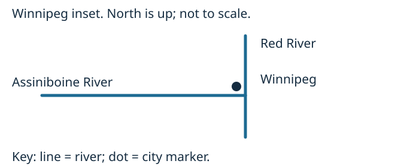

# Day 25 exit ticket

Original city-plan locator; not a photograph.

**s02-X25**

Use the Winnipeg inset and its key. Explain Winnipeg's position using the river symbols.

_________________________________________________________________

_________________________________________________________________

_________________________________________________________________
