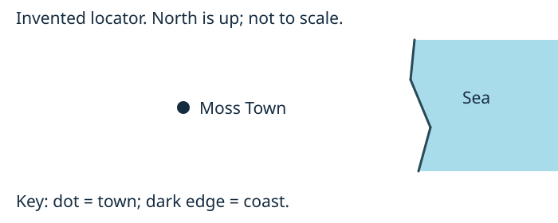

# Day 28 exit ticket

**s02-X28**

The made-up Moss Town map places its marker inland. A report calls it coastal. Write a speaker note correcting the report with map evidence.

______________________________________________________________________

______________________________________________________________________
