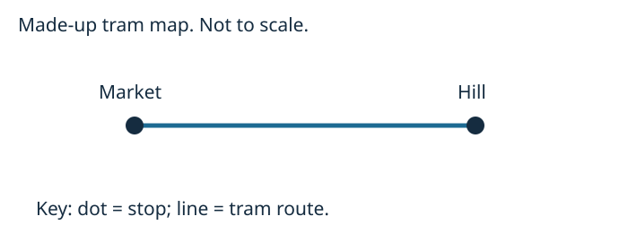

# Day 29 exit ticket

**s02-X29**

Made-up tram map: Market and Hill stops. Depot list: three trams. Peer explanation: The route has two stops. Only one tram runs. Give a supported strength and an accuracy repair using these records.

______________________________________________________________________

______________________________________________________________________
