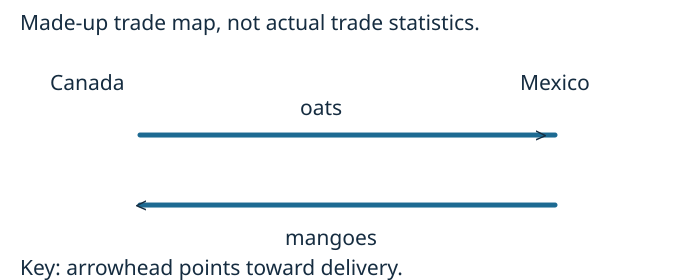

# Day 31 exit ticket

**s02-X31**

Use the made-up trade map. Explain what the oats arrow means for both countries.

_________________________________________________________________

_________________________________________________________________

_________________________________________________________________
