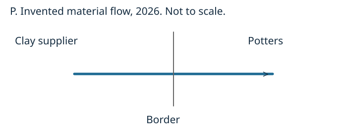

# Day 34 exit ticket

**s02-X34**

Made-up Map P sends clay across a border to potters. Workshop Record R shows more pots sold back across that border. State a tentative reliance claim using one detail from each record.

______________________________________________________________________

______________________________________________________________________
