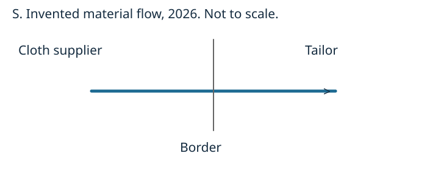

# Day 35 exit ticket

**s02-X35**

Made-up Map S sends foreign cloth to a tailor. Buyer Record T shows lower clothing prices and fewer rival-shop orders. Write a claim explaining uneven trade effects using both records.

_________________________________________________________________

_________________________________________________________________

_________________________________________________________________
