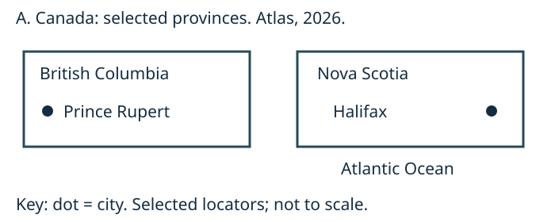

# Unseen sources

## A

Facts: regional department; provincial place-name office. Original.

## B
Transport Canada, 2026. Digital cargo summary.

| Port | Province | Activity |
|---|---|---|
| Halifax | Nova Scotia | Cargo handling |
| Prince Rupert | British Columbia | Cargo handling |

Marine-port facts paraphrased.

## C
Classroom article, 2026. Made up.
Prince Rupert is in British Columbia. Prince Rupert is the nicest city.
Original.

## D
Workshop, Canada, 2026. Made-up order table for production.

| Source | Part |
|---|---|
| Mexico | Tubes |
| United States | Wheels |
| Canada | Bicycle assembly |

United States orders: 4, then 7 bicycles weekly.
Canadian workshop: more worker shifts; rival assemblers: fewer orders.
Mexican supplier workers: more orders; rival tube makers: fewer sales.
Original.

## E
United States buyers, 2026. Made-up comparison.
Buyers pay less; rival bicycle assemblers lose orders.
Original.

## F
Seller, undated. Made-up promotion.
More bicycle trade helps everybody. Buy more bicycles!
Original.

## Peer explanation
Everyone in Halifax works on ships. Halifax is beside the Pacific. Cargo moves there.
Original.
