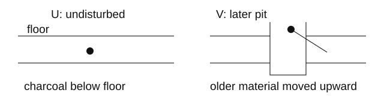

# Day 43 exit ticket

Invented diagrams.

Name: __________________

Which dig diagram lets depth help order the layers: U or V?

________________________________________________________

Explain why recording a find's location and layer helps another researcher.

________________________________________________________
