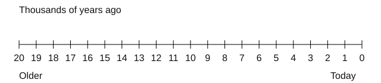

# Day 44 exit ticket

Each tick represents one thousand years.

Name: __________________

Place 18,000, 11,000 and 7,000 years ago on the supplied line.

________________________________________________________

Circle the earliest of those three dates.

________________________________________________________
