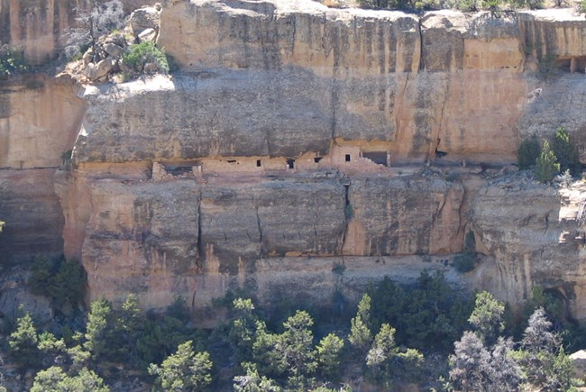

# Wall and Pueblo Today

Mesa Verde National Park. Photographer: National Park Service; date not supplied; public domain.

Pueblo Today: The cultural center is owned by nineteen distinct Pueblo tribes in New Mexico.

Original summary of the Indian Pueblo Cultural Center FAQs, undated; source 42C.

Write a supporting question about evidence: __________________________________

What evidence would help? __________________________________
