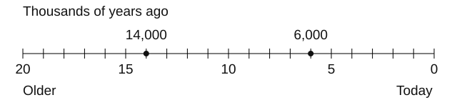
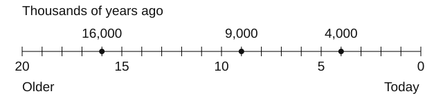

# Reading a given line

One gap represents one thousand years.

Read the label at each model point: __________  __________

Write each point's printed date in words: ______________________________

Someone labels the 16 point as 6,000 years ago.

Correct only that label: ______________________________

All dates here are invented number practice.
