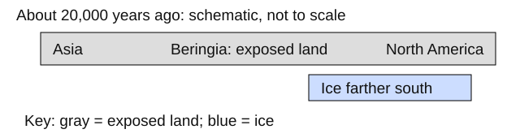

# Day 45 exit ticket

Source 45A; original schematic with separate land and ice keys.

Name: __________________

What could the exposed land on this inset allow?

________________________________________________________

Explain whether this land connection establishes a usable route through the southern ice.

________________________________________________________
