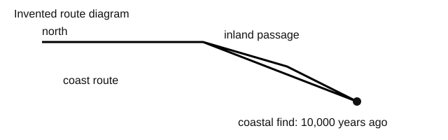

# Day 48 exit ticket

Invented: inland passage usable by 13,000 years ago; coastal travel also possible then.

Name: __________________

Which route claim does the new date support?

________________________________________________________

What further evidence could help distinguish the routes?

________________________________________________________
