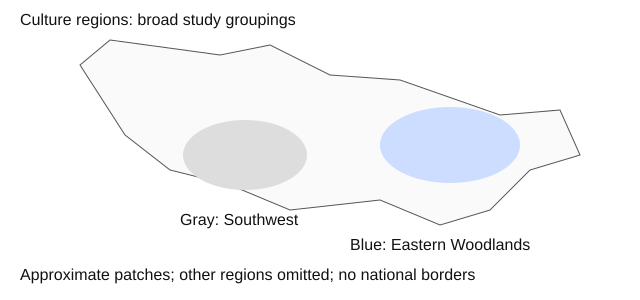

# Day 49: Groupings and nations

## Teacher page

### Before class
Read the teacher-only keys. Return day 48 papers with one priority cue. Keep s03 exit 49 covered. Check its printed bar measures two inches; dot spacing matches that bar. Prepare separate whole and half strips for a 100-kilometer practice bar. Put s03 map practice beside the dated schematic. Select six unheard names on s03 record.

### The day

#### 5 min. Return and repair
Return every day 48 paper. If many day 48 tickets showed error H, use [[s03-P49-R]] together. Error B treats presence as a complete journey; error C treats an available path as a traveled one. Use the same short record for the priority group; others revise their returned evidence links. Finish in Map work's first five minutes.

#### 8 min. Map model
Review homeland from grade 3 day 72 and present lands from day 75. A homeland is long-known home land; present lands are lands held today. Introduce culture region: a broad, approximate cultural grouping. Point to the schematic's title, date and key. It groups places for study; it is not a government's territory. No national boundaries are drawn.

Use [[s03-P49a]] to model tracing just one patch. Keep the nation labels on separate lines. A nation's own introduction and a museum's grouping have different makers and purposes. Do not locate a nation from shading alone.

#### 17 min. Map work
First five minutes finish the priority repair. Pairs finish tracing, then each answers [[s03-P49d]] using the separate maker labels. Review grade 3's paper-strip model from day 7. Lay a strip on a whole practice bar; fold another in half. Give ruler directions explicitly, then use [[s03-P49b]] and [[s03-P49c]]. These isolated bars have no settlement pair.

Review day 42's source log. Add the museum as map source, date not supplied, for public learners. The schematic is ours, drawn 2026. Collect each child's page for written feedback; no child speaks for a nation.

#### 5 min. Question board
Review the board routine. Partners each take 45 seconds describing one annotation, 1.5 minutes in parallel. During this block hear six staggered single 45-second turns, 4.5 minutes, with no queue. A public pass is allowed. If repairs continue, collect writing instead. Post one grouping observation.

#### 5 min. Exit ticket
Reveal the invented map on s03 exit 49: [[s03-X49a]] [[s03-X49b]]. Each child works independently on paper. After class, allow 30 times 30 seconds, 15 minutes, for both components, plus ten minutes for practice feedback. Record shown, shown with help, not yet seen, separately per component. Note access support separately. Return all papers on day 50.

### Other rooms
No screen: use print. No printer: hand-copy the schematic and exit map separately, preserving each map's bar-to-distance ratio. Label invented settlements. Do not measure a screen.

### At home
**Swap.** No printer: draw separate practice patches and the complete exit map, including its bar.
**Skip.** Roster and public sharing.
- **5 min. Return.** Use [[s03-P49-R]] if day 48 feedback needs repair.
- **8 min. Map model.** Read the title and key. Start [[s03-P49a]].
  **Say.** "What does the key group?" Expect broad cultures, not one government.
- **17 min. Map work.** Finish tracing. Use [[s03-P49d]], then [[s03-P49b]] and [[s03-P49c]]. Mark a strip against a whole bar before folding a second strip. Read each maker label separately.
- **5 min. Exit ticket.** Reveal exit-49.md. Give [[s03-X49a]] and [[s03-X49b]] alone. Compare with the teacher-only key afterward.

### Shorter or longer
Shorter: omit public sharing, keeping map work and exit. Longer: compare the purposes of two maker labels.

### Words and supports
Review homeland, present lands and scale bar. Culture region means approximate cultural grouping. Read labels neutrally; accept child-directed dictation. Keep the key visible during measuring.

### Tomorrow
Day 50 reads stone-tool and pottery photographs. Error D treats shading as one nation; scale misses mismatch strip and bar. Return all papers in Return and repair and Observation work's first five minutes. More than ten misses: shared priority repair; otherwise a group.

### Credit
Ours. Source 49A informs broad groupings. Sources 42D and 47A supply separate nation authorship. Settlements are invented.

## Student page
### Side 1
**I can read a map's cultural groupings.**

**Review: supported travel.**
[[s03-P49-R]] {small}

**Study map, drawn 2026.**

Source 49A: museum teaching map, date not supplied.
Left patch: Southwest. Right patch: Eastern Woodlands.
Other regions are omitted. These patches show no national borders.

[[s03-P49a]] {small}

### Side 2
**Separate maker labels.**
Hopi Tribe introduction, undated. Maker: Hopi Tribe.
Osage public history, 2013. Maker: Andrea A. Hunter, Osage Nation.
Sources 42D and 47A. Public information for readers.

[[s03-P49d]] {small}

**Review: isolated scale bars.**
One practice bar stands for 100 kilometers.
Draw a bar. Mark its whole length with a strip.
Fold a second matching strip in half.

[[s03-P49b]] {small}
[[s03-P49c]] {small}
