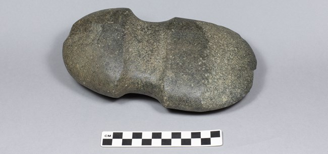
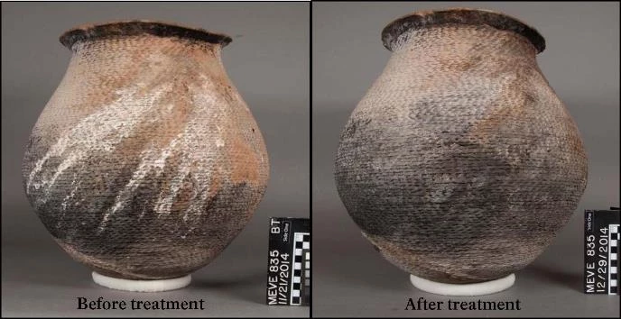

# Day 50: Visible details and careful inferences

## Teacher page

### Before class
Read teacher-only keys. Keep s03 exit 50's photographs covered. Retrieve s03 map practice for reminders. Use s03 observation practice as your teaching master; the day page holds children's responses. Prepare the separate teaching axe and jar images. Return day 49 papers with one priority cue. Select six unheard names on s03 record.

### The day

#### 5 min. Return and repair
Return all day 49 papers, including every written task. If many day 49 tickets showed error D, use [[s03-P50-R]] together. A scale miss gets [[s03-P50-R2]] instead. Otherwise meet the priority group while others revise a returned annotation. Review culture region: broad grouping, not a government. Finish in Observation work's first five minutes.

#### 8 min. Observation model
Review day 43's observation and inference: a visible detail and an explanation drawn from evidence. Introduce stone tool and pottery. A stone tool is shaped stone used for a task. Pottery is shaped, fired clay. Sources s03-IMG16 and s03-IMG3 identify these everyday objects; do not guess a maker's nation from appearance.

Show only the axe. Use [[s03-P50a]] before pointing out its groove. Trace the visible feature without adding a job or belief. Explain separately that deliberate stone shaping requires skill. An object cannot reveal every person's work or private beliefs. The jar image shows two conservation views of one vessel, not two finds.

#### 17 min. Observation work
First five minutes finish priority repairs. In pairs children annotate the axe, then the jar with [[s03-P50b]]. Each records only visible labels. Put the image task aside. Independently classify supplied statements with [[s03-P50-sort1]], [[s03-P50-sort2]] and [[s03-P50-sort3]]. These are separate judgments, not paired feature-and-inference answers.

For error E, return to visible words without interpreting a design. For error P, contrast some skilled making with everyone's occupation. Review the source log: maker, date not supplied, museum photograph for public learners. Collect pages for descriptive feedback.

#### 5 min. Question board
Review the board routine. Partners each describe one label for 45 seconds, 1.5 minutes in parallel. During the block hear six staggered single 45-second turns, 4.5 minutes; public pass allowed. Continue repairs instead if needed. Everyone submits labels, including children not heard. Post a visible detail only.

#### 5 min. Exit ticket
Reveal s03 exit 50: [[s03-X50a]] [[s03-X50b]]. Each child independently writes beside the two new photographs. Keep teacher keys covered. After class allow 30 times 40 seconds, 20 minutes, for both responses, plus ten minutes for practice feedback. Record shown, shown with help, not yet seen per component; access support separately. Return all papers on day 51.

### Other rooms
No screen: use the printed images. No printer: display saved photographs and copy stems onto paper. Describe visible outlines neutrally; never replace a photograph with an unlabeled drawing.

### At home
**Swap.** No printer: show the saved photographs and copy the asks onto paper.
**Skip.** Roster and public sharing.
- **5 min. Return.** Choose [[s03-P50-R]] or [[s03-P50-R2]] for day 49's priority.
- **8 min. Model.** Look at the teaching axe. Try [[s03-P50a]] before showing the groove.
  **Say.** "Which words describe something visible?" Expect groove or tapered edge.
- **17 min. Observe.** Use [[s03-P50b]]. Put images aside, then classify [[s03-P50-sort1]], [[s03-P50-sort2]] and [[s03-P50-sort3]]. Read each statement neutrally.
- **5 min. Exit ticket.** Uncover exit-50.md with both photographs. Give [[s03-X50a]] and [[s03-X50b]] independently. Use the separate key afterward.

### Shorter or longer
Shorter: omit public sharing, keeping both observations, statement sorting and exit. Longer: identify a further visible feature without interpreting designs.

### Words and supports
Review artifact, observation, inference and limit from day 43. Stone tool means shaped stone used for a task. Pottery means shaped and fired clay. Allow pointing before child-directed dictation. Do not ask about family beliefs or ancestry.

### Tomorrow
Day 51 separates food evidence from building observations. Error E infers beliefs; error P infers everyone's occupation. Return all papers in Return and repair and Evidence work's first five minutes. More than ten misses: shared priority repair; otherwise a group. Use a fresh partial statement.

### Credit
Ours. Teaching photographs: Sources s03-IMG16 and s03-IMG3. Exit photographs: Sources s03-IMG5 and s03-IMG6. Credits accompany the images.

## Student page
### Side 1
**I can read object photographs carefully.**

**Review: grouping and scale.**
[[s03-P50-R]] {small}
[[s03-P50-R2]] {small}

**Visible details only.**

Saugus collection SAIR 3878. Photograph: NPS/Lissa Herzing.
Date not supplied. Public domain. Source s03-IMG16.

[[s03-P50a]] {small}

### Side 2

Mesa Verde collection MEVE 835. Photograph: NPS.
Date not supplied. Public domain. Source s03-IMG3.
These are two views of one object.

[[s03-P50b]] {small}

**Set the images aside. Classify each supplied statement.**
Use: visible / supported possibility / goes too far.

[[s03-P50-sort1]] {small}
[[s03-P50-sort2]] {small}
[[s03-P50-sort3]] {small}
