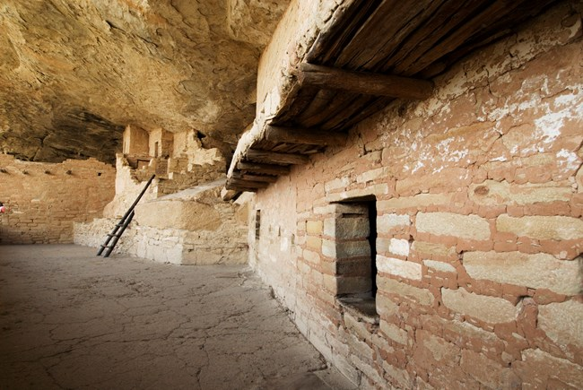
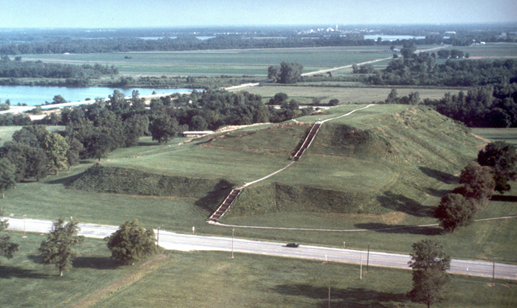

# Day 51: Food records and built places

## Teacher page

### Before class
Read teacher-only keys. Keep s03 exit 51 covered. Retrieve s03 observation practice for reminders and s03 food sequence for today's stages. Shuffle five stage strips per pair: growing, harvest, drying, storage, food between harvests. Prepare the separate teaching structure images. Return day 50 papers with one priority cue. Select six unheard names on s03 record.

### The day

#### 5 min. Return and repair
Return all day 50 papers, including every written task. If many day 50 tickets showed error E, use [[s03-P51-R2]] together. Error P gets [[s03-P51-R]] instead. Otherwise meet the priority group while others revise their returned observation labels. Review observation and inference from day 43. Finish repairs in Evidence work's first five minutes.

#### 8 min. Settlement model
Introduce storage, keeping food for later use. Source 42B reports farming and winter food storage at Mesa Verde. Source 51F describes dried-food storage. Model arranging growing before harvest with [[s03-P51a]]; leave later stages for pairs. Explain that keeping food makes it available after harvest, supporting longer stays. Farming does not mean every person did the same work.

Put the food record aside. Introduce mound as constructed raised earthwork and cliff dwelling as rooms within a cliffside alcove. Use separate teaching photographs, identifying only visible material forms. The site captions establish what these places are; walls alone do not establish crops.

#### 17 min. Evidence work
First five minutes finish priority repairs. Pairs arrange their five strips, then each child completes [[s03-P51a]] and [[s03-P51b]]. Drying and storage can both help preserve food; accept a supported distinction. The sequence describes one possible food process, not every food or community.

Set food records aside. Children independently label masonry with [[s03-P51c]] and trace the mound outline with [[s03-P51d]]. Use visible words; do not infer a ruler, belief or every person's job. Review the source log: distinguish the written crop account from image evidence. Collect all pages for descriptive feedback.

#### 5 min. Question board
Review the board routine. Partners each take 45 seconds explaining one stage, 1.5 minutes in parallel. During this block hear six staggered single 45-second turns, 4.5 minutes; public pass allowed. If repair needs attention, collect writing instead. Post a food-process observation separately from a structure label.

#### 5 min. Exit ticket
Reveal s03 exit 51's Farming Card and fresh photograph: [[s03-X51a]] [[s03-X51b]]. Each child answers independently on paper. After class allow 30 times 35 seconds, 17.5 minutes, for both responses, plus ten minutes for practice feedback. Record shown, shown with help, not yet seen per component, with access support separate. Return all papers on day 52.

### Other rooms
No screen: use print. No printer: hand-copy stage strips and stems; show saved photographs. Neutral descriptions support access without supplying a farming inference. No digging or object handling.

### At home
**Swap.** No printer: write stage names on scrap strips and show saved photographs.
**Skip.** Roster and public sharing.
- **5 min. Return.** Choose [[s03-P51-R]] or [[s03-P51-R2]] for day 50's priority.
- **8 min. Model.** Start [[s03-P51a]] with growing before harvest. Read the supplied food record.
  **Say.** "Which stage keeps food for later?" Expect storage; accept drying with a reason.
- **17 min. Evidence work.** Finish [[s03-P51a]] and [[s03-P51b]]. Put food notes aside. Use [[s03-P51c]] and [[s03-P51d]] with the teaching images. Keep observations separate from crop claims.
- **5 min. Exit ticket.** Reveal exit-51.md. Give [[s03-X51a]] and [[s03-X51b]] alone. Read the separate key afterward.

### Shorter or longer
Shorter: omit sharing, keeping food sequencing, separate structure observations and exit. Longer: compare drying and storage as different ways food remains available.

### Words and supports
Storage means keeping food for later. Mound here means constructed raised earthwork. Cliff dwelling means rooms in a cliffside alcove. Review observation, inference and limit. Let children move strips, point, rehearse or direct a scribe.

### Tomorrow
Day 52 studies Mesa Verde and distinct living Pueblo communities. Error P claims walls prove everyone's occupation. Return all day 51 papers in Return and repair and Site work's first five minutes. More than ten misses: shared priority repair; otherwise a group. Use fresh crop-record selection.

### Credit
Ours. Food: Sources 42B and 51F. Teaching images: Sources s03-IMG4 and s03-IMG8. Exit: Sources 51E and s03-IMG7.

## Student page
### Side 1
**I can separate food records from building evidence.**

**Review: evidence limits.**
[[s03-P51-R]] {small}
[[s03-P51-R2]] {small}

**Food process.**
The park reports farming and winter food storage at Mesa Verde.
Dried food was stored there. Sources 42B and 51F.
Original summaries for learners; page dates not supplied.

Use the shuffled strips: growing, harvest, drying, storage, food between harvests.
[[s03-P51a]] {small}
[[s03-P51b]] {small}

### Side 2
**Put food records aside. Look for material details.**

Balcony House, Mesa Verde. NPS photograph, date not supplied; public domain.
Source s03-IMG4.
[[s03-P51c]] {small}

Cahokia. Cahokia Mounds State Historic Site photograph, via NPS.
Date not supplied. Source s03-IMG8.
[[s03-P51d]] {small}
