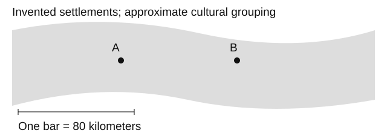

# Day 49 exit ticket

Print at actual size. Key: gray means an approximate culture-region grouping.

Name: __________________

Measure the settlement distance using the scale bar.

________________________________________________________

Explain why the shading does not define a nation's border.

________________________________________________________
