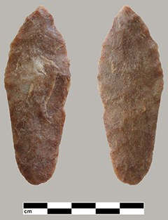
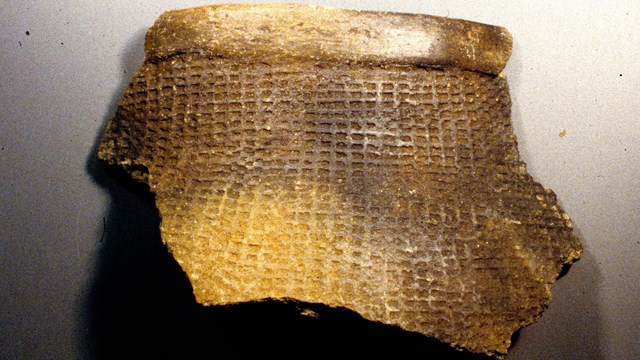

# Day 50 exit ticket

A: Mesa Verde stone object; NPS photograph, date not supplied; public domain.

B: Russell Cave fragment; NPS photograph, date not supplied; public domain.

Name: __________________

Give one visible feature supporting an inference about making in photograph A.

________________________________________________________

Give one visible feature supporting an inference about making in photograph B.

________________________________________________________
