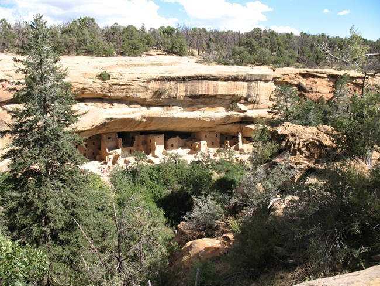

# Day 51 exit ticket

Farming Card: The park reports crop growing and winter food storage at Mesa Verde.

Source 51E, original summary.

NPS photograph; date not supplied; public domain.

Name: __________________

How could growing and storing crops support longer settlement?

________________________________________________________

What further evidence would connect this building with farming?

________________________________________________________
