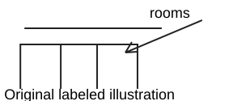
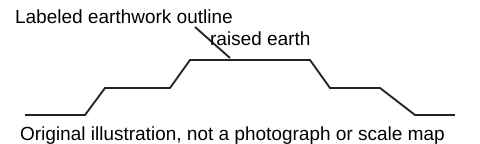

# Food evidence, then structure observations

Original sequence based on the park's farming and storage account, source 42B.

Crop growing | Harvest | Drying | Storage | Food between harvests

Number the stages in order: __________________

Underline the written stage that preserves food between harvests.

Original teaching illustration, 2026; source 51F informs the room label.

Check the supplied rooms label against its marked arrow. __________________

Original teaching illustration, 2026; source 53H informs the shape.

Trace the labeled earthwork outline. __________________

A mound is constructed raised earthwork.

A cliff dwelling has rooms within a cliffside alcove.

Keep the food task separate from the structure labels.
