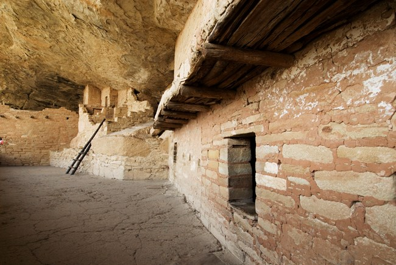
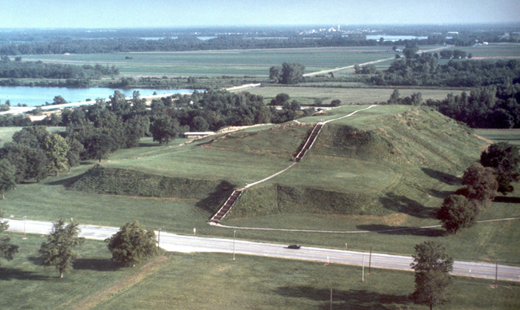

# Food evidence, then structure observations

Original sequence based on the park's farming and storage account, source 42B.

Crop growing | Harvest | Drying | Storage | Food between harvests

Number the stages in order: __________________

Underline the written stage that preserves food between harvests.

Balcony House, Mesa Verde. NPS; date not supplied; public domain.

Write visible material words only: __________________

Cahokia. NPS; date not supplied; public domain.

Trace the raised outline. Write visible words only: __________________

A mound is constructed raised earthwork.

A cliff dwelling has rooms within a cliffside alcove.

Keep the food task separate from the photograph observations.
