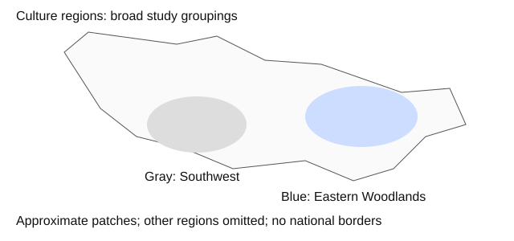

# Reading broad groupings

Original schematic, drawn 2026, informed by source 49A.

Culture region: a broad approximate cultural grouping, not a nation or political border.

Homeland: land a nation's people have known as home for a very long time.

Present lands: lands a nation holds today.

Trace the two grouping patches using separate pencils.

Separate source labels: Hopi Tribe introduction; Osage Nation public history.

Match each label to its maker, without inventing a national boundary.

Scale review: lay a paper strip along one whole bar, then half a bar.

| Bar count | Distance with a 100-kilometer bar |
|---|---|
| One | __________ |
| Half | __________ |

These isolated bar tasks have no settlement locations.
