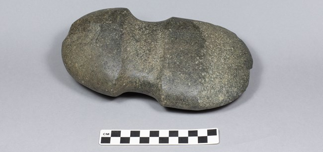
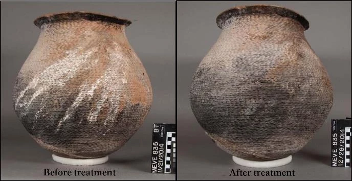

# Looking closely

Saugus collection SAIR 3878. NPS/Lissa Herzing; date not supplied; public domain.

Mark a groove or tapered edge. Write only visible words: __________________

Mesa Verde collection MEVE 835. NPS; date not supplied; public domain.

Mark one rim or curve. Write only visible words: __________________

Sort these supplied statements separately: visible / supported possibility / goes too far.

A rim curves. __________

Shaping a stone involves skill. __________

Every person did one job. __________

Sources: s03-IMG16 and s03-IMG3. No object handling.
