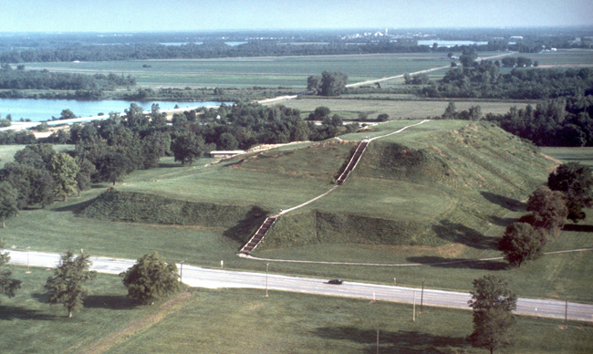

# Day 53: Cahokia and attributed history

## Teacher page

### Before class
Read teacher-only keys. Keep s03 exit 53's image and geography card covered. Retrieve s03 living nations and s03 site practice. Prepare the teaching earthwork view and separate author/date label. Return day 52 papers with one priority cue. Select six unheard names on s03 record. Use only Hunter's secular geography, without burial or sacred content.

### The day

#### 5 min. Return and repair
Return all day 52 papers, including every written task. If many day 52 tickets showed error G, use [[s03-P53-R]] together as a reminder of a living nation. Otherwise meet the priority group; others revise returned source labels. Review day 52: movement is not disappearance. Finish in Source work's first five minutes.

#### 8 min. Cahokia model
Review day 51's mound: constructed raised earthwork. Introduce Cahokia Mounds State Historic Site's name and preserved earthworks. Source 53H establishes construction before European arrivals. In the teaching view, distinguish the raised earth terraces from the visitor stairs. The stairs are not evidence of ancient stair construction.

Put the photograph aside. Review day 47's attribution using [[s03-P53]]. Source 47A is Andrea A. Hunter's public account for the Osage Nation, published in 2013. It discusses ancestral geography, including several related nations. These are living nations, not interchangeable names. Identify the maker before discussing any account; a photograph cannot identify every builder.

#### 17 min. Source work
First five minutes finish priority repairs. Children independently annotate author and date with [[s03-P53]] and [[s03-P53-T]]. Review the source log: 2013 dates this account, not the earthwork. Its public readers are learning Osage history. Hunter also discusses Omaha, Ponca and Kaw ancestors; this is not a list of every Cahokia builder.

Set the account label aside. Use [[s03-P53-O]] with the teaching earthwork photograph as an observation-only reminder. Children trace contours, without a combined photo-and-account explanation. Review ancestor and descendant from day 52. Correct error P by separating visible form from identity. Collect all notes for descriptive feedback; no child represents a nation.

#### 5 min. Question board
Review the board routine. Partners each take 45 seconds discussing an author label, 1.5 minutes in parallel. During this block hear six staggered single 45-second turns, 4.5 minutes; public pass allowed. If repairs continue, collect writing instead. Post one source-maker observation.

#### 5 min. Exit ticket
Reveal s03 exit 53's new view and public account: [[s03-X53a]] [[s03-X53b]]. Each child writes independently. After class allow 30 times 35 seconds, 17.5 minutes, plus ten minutes for practice feedback. Record shown, shown with help, not yet seen per component, access support separately. Return all papers on day 54.

### Other rooms
No screen: use print. No printer: show the saved photographs and hand-copy labels and stems. A drawing may support teaching if labeled illustration; it cannot replace the photograph exit. No live visitor is needed.

### At home
**Swap.** No printer: copy labels and stems, showing the saved photographs.
**Skip.** Roster and public sharing.
- **5 min. Return.** Use [[s03-P53-R]] for day 52's priority.
- **8 min. Model.** Read the site's name and separate author label.
  **Say.** "Whose public account is this?" Expect Andrea A. Hunter, Osage Nation.
- **17 min. Source work.** Use [[s03-P53]] and [[s03-P53-T]]. Put the label aside. Trace the teaching image with [[s03-P53-O]]. Separate the mound's form from the visitor stairs and from builders' identities.
- **5 min. Exit ticket.** Reveal exit-53.md. Give [[s03-X53a]] and [[s03-X53b]] independently. Read the separate key afterward.

### Shorter or longer
Shorter: omit public sharing, keeping separate annotations and exit. Longer: distinguish a publication date from a photograph date that is not supplied.

### Words and supports
Review mound, ancestor, descendant and limit. Attribution names the account's maker. Pointing, enlarged contours and child-directed dictation preserve the task. Do not ask children about ancestry or sacred knowledge.

### Tomorrow
Day 54 applies preservation reasoning. Error P assigns every builder from one image; error G claims no descendants remain. Return all day 53 papers in Return and repair and Preservation work's first five minutes. More than ten misses: shared priority repair; otherwise a group.

### Credit
Ours. Sources 47A and 53H support teaching. Teaching photograph: Source s03-IMG8. Exit: Sources 53E and s03-IMG10. No exclusive-descent claim is made.

## Student page
### Side 1
**I can distinguish a structure from an attributed account.**

**Review: a living nation.**
[[s03-P53-R]] {small}
Source 42D: Hopi Tribe public introduction, undated. Original summary.

**Separate source label.**
Andrea A. Hunter, Osage Nation, 2013.
Public history for readers, Source 47A.
The publication date does not date the earthwork.

[[s03-P53]] {small}
[[s03-P53-T]] {small}

### Side 2
**Set the source label aside. Review the teaching view.**

Cahokia Mounds State Historic Site, via NPS.
Photograph date not supplied. Source s03-IMG8.
The visitor stairs are separate from the raised earthwork.

[[s03-P53-O]] {sketch}
