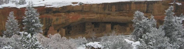

# Day 52 exit ticket

NPS photograph; date not supplied; public domain.

Pueblo Continuity Card: Each New Mexico Pueblo is a distinct recognized tribe.

These communities have their own governments. Source 52E; original public secular summary.

Name: __________________

What material evidence survives in this site view?

________________________________________________________

What continues among the people described on the card?

________________________________________________________
