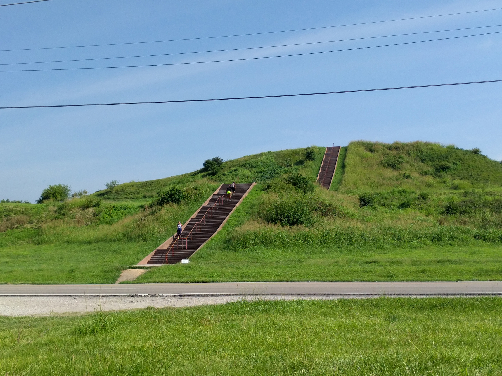

# Day 53 exit ticket

Great Rivers Country; date not supplied; public domain.

Osage Geography: Hunter's account links Osage ancestors with the Cahokia/St. Louis area.

Source 53E, 2013; original secular summary, not exclusive descent.

Name: __________________

What does this earthwork photograph add to our knowledge?

________________________________________________________

What does the Osage account add about this place?

________________________________________________________
