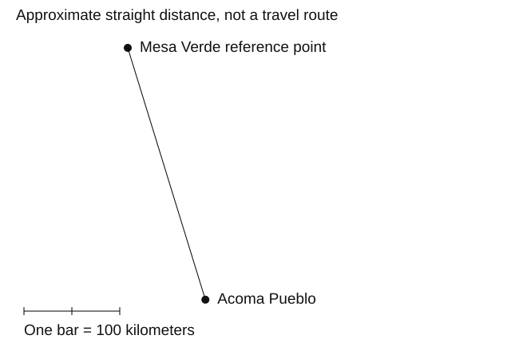

# Mesa Verde and Acoma Pueblo

Original locator, drawn 2026; approximate endpoints, not a road route or a descent claim.

Measure the printed line with a strip. Compare it with the scale bar.

Bar count: __________   Approximate kilometers: __________

Sources: 52M and 52N. Two communities are not one nation.

Teacher reference and print calibration are in teacher-key.md.
