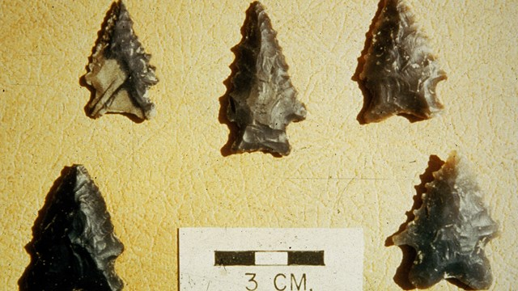
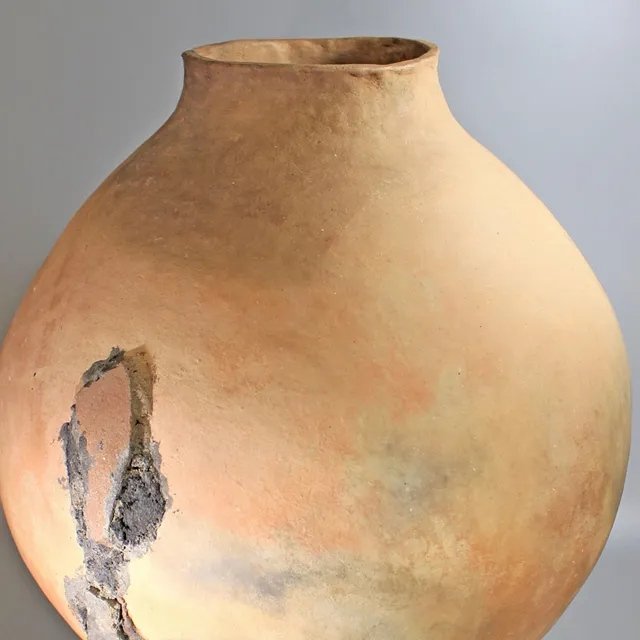
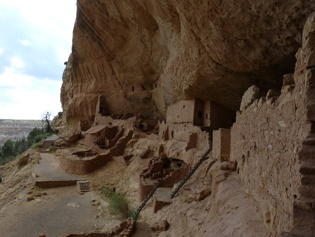
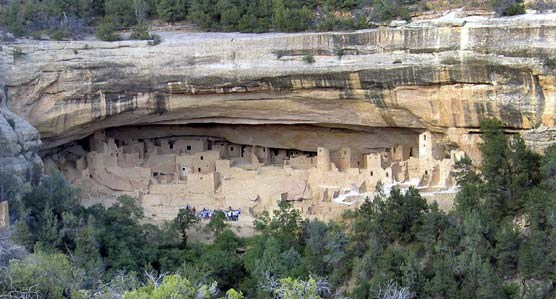
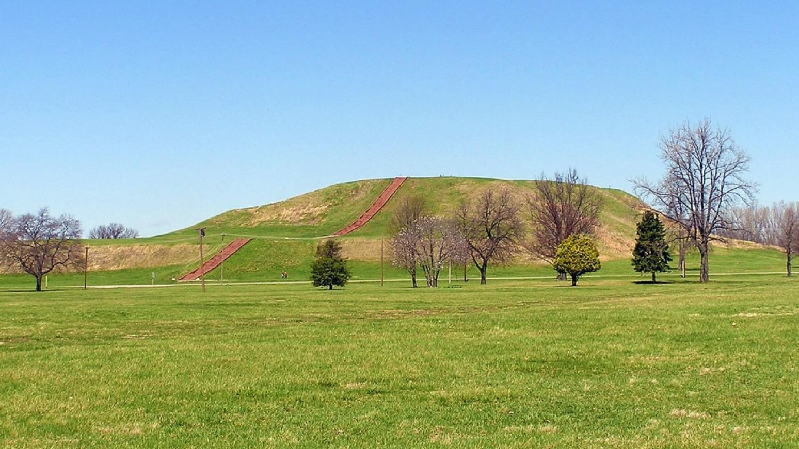

# Unit 3 assessment

A: Park and geological researchers report White Sands footprints about 21,000 to 23,000 years old.

Recorded layers, seeds, pollen and light-based sediment dating inform their work.

B: Pedersen's team reports food-supporting corridor conditions by about 12,600 years ago.

Their study sampled one bottleneck.

| B: Russell Cave | C: Joshua Tree JOTR 254 |
|---|---|
|  |  |
| D: Cahokia | E: Long House, Mesa Verde |
|  |  |

Photographs: National Park Service, undated, public domain.

S, invented: pottery and stored crops beside house floors.

T, invented: repeated building alignment compared with seasonal sunrise observations.

| Mesa Verde National Park | Cahokia Mounds State Historic Site |
|---|---|
|  |  |

Pueblo account: living distinct communities. Osage account: ancestral Cahokia connections.

Site photos: NPS, public domain; Northfielder, CC BY 2.0; both undated.

## 1

Place A and B on the timeline.

________________________

Compare inland and coastal possibilities using A and B.

________________________

Does depth alone date finds in the pit diagram?

________________________

## 2

Locate both sites using C.

________________________

Identify B using one visible detail.

________________________

Identify C using one visible detail.

________________________

Identify D using one visible detail.

________________________

Identify E using one visible detail.

________________________

What does large construction suggest about work?

________________________

Does C's shading mark national borders?

________________________

## 3

How do recorded digs strengthen theories?

________________________

What do artifacts and organic traces contribute?

________________________

Why compare climate and dating evidence with specialists?

________________________

What could S suggest about settlement?

________________________

What could T suggest about seasonal observation?

________________________

## 4

Explain each named place's contribution to American history.

________________________

Why protect evidence and respect descendants' connections?

________________________

## 5

Answer our unit question with a claim, reasons and a limit.

________________________

Support your claim using distinct details from two named makers.

________________________

Explain why an accurate answer matters to another person.

________________________
